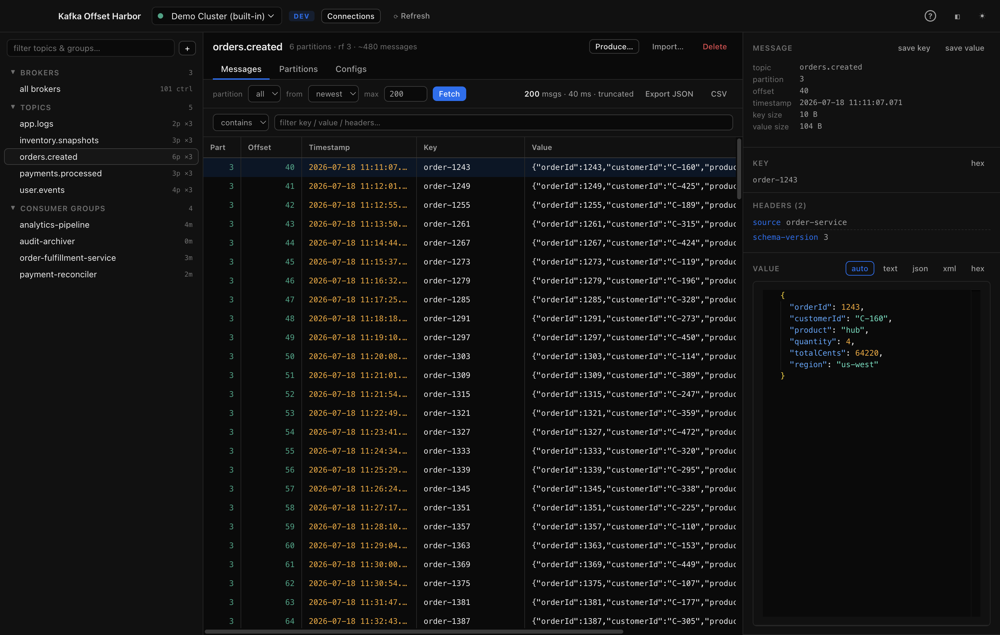
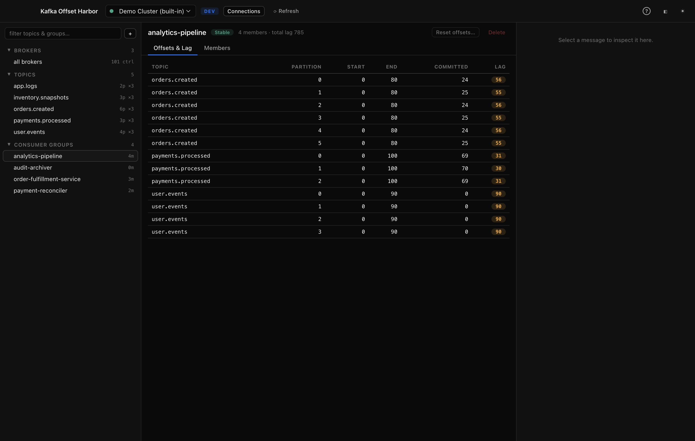
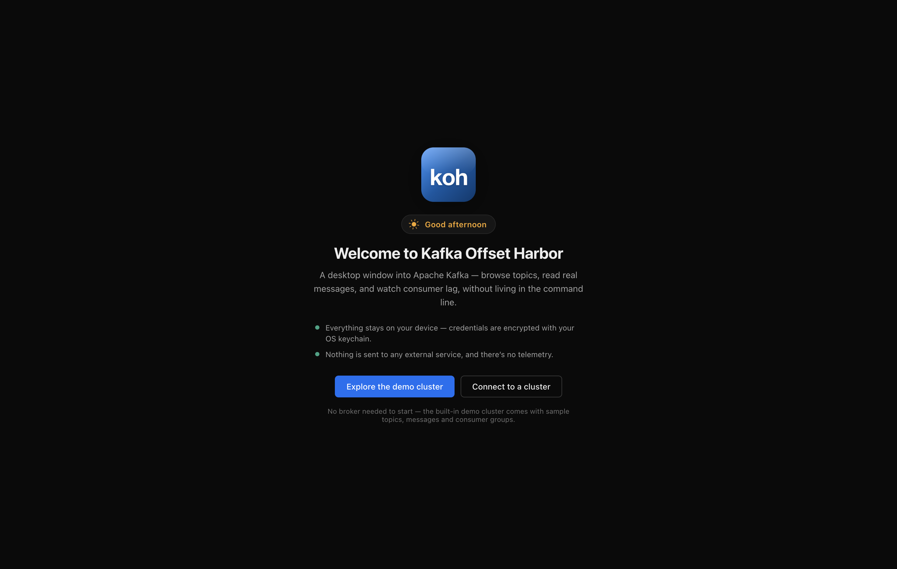

<div align="center">


# Kafka Offset Harbor

**A desktop app for looking inside Apache Kafka** — browse topics and messages,
watch consumer lag, and reset offsets safely. Free and open source.

[](https://github.com/rajeshkumaravel/kafka-offset-harbor/actions/workflows/ci.yml)
[](https://github.com/rajeshkumaravel/kafka-offset-harbor/releases)
[](https://github.com/rajeshkumaravel/kafka-offset-harbor/tags)
[](https://github.com/rajeshkumaravel/kafka-offset-harbor/releases)
[](https://github.com/rajeshkumaravel/kafka-offset-harbor/releases/latest)
[](LICENSE)

[](https://www.electronjs.org/)


[](https://nodejs.org/)


[](#download)
[](#privacy--no-network-calls-of-its-own)
[](#auto-updates)
[](CONTRIBUTING.md)
[](https://github.com/rajeshkumaravel/kafka-offset-harbor/stargazers)

[Visit Website](https://rajeshk.dev/kafka-harbor?utm_source=github&utm_medium=readme&utm_campaign=kafkaharbor) · [Download](#download) · [Features](#features) · [Quick start](#quick-start) · [Contributing](#contributing)



</div>

---

## Why

Kafka moves the data between a company's systems — orders, payments, events —
but that data is effectively invisible: it lives inside the cluster with no
built-in window to look at it. Answering *"did this message arrive?"*, *"why is
this consumer behind?"*, or *"can we replay this?"* usually means a pile of CLI
flags.

Kafka Offset Harbor is that window. It's a local-first desktop app: your
credentials never leave your machine, and there's no telemetry.

## Download

Grab the latest installer from the [**Releases**](../../releases) page:

| Platform | File |
|----------|------|
| macOS (Apple silicon / Intel) | `.dmg` |
| Windows (x64) | `.exe` (NSIS installer) |
| Linux | `.AppImage` (x64 / arm64) or `.deb` (x64) |

Builds are **unsigned** — on macOS use right-click → *Open* the first time
(Gatekeeper); on Windows dismiss the SmartScreen prompt. No broker needed to try
it: the app ships with a **built-in demo cluster**.

Works with any broker that speaks the Kafka protocol supported by
[kafkajs](https://kafka.js.org) (Apache Kafka 0.10+), including
Kafka-compatible services.

## Features

### Explore your cluster
- **Cluster tree** — brokers (with controller), topics (partition &
  replication counts), and consumer groups in one filterable sidebar.
- **Multiple connections** — saved and persisted between launches, with optional
  dev/stage/prod colour badges.

### Read messages
- **Flexible fetch** — from newest, oldest, a specific offset, or a point in
  time; per partition or across all of them.
- **Fast grid** — virtualized, handles thousands of rows without breaking a sweat.
- **Powerful filters** — `contains`, `regex`, or `JSONPath` across key, value and headers.
- **Readable payloads** — auto pretty-printed JSON/XML, plus raw text and hex
  views, rendered by the Monaco (VS Code) editor. Headers, byte sizes, and
  tombstones all shown.
- **Export** — send results to JSON or CSV, or save a single key/value to disk.

### Fix consumers


- **Lag at a glance** — per-partition start / end / committed offsets with
  colour-coded lag, plus group state, members and partition assignments.
- **Offset resets** — move a group to earliest, latest, a specific offset, or a
  timestamp; per partition or whole-topic. Guarded so it only runs when the
  group is idle.

### Produce & administer
- **Produce** — keyed or keyless messages, tombstones, custom headers, and
  repeat-N for generating test data.
- **Import** — replay a JSON array of messages into a topic.
- **Topic admin** — create/delete topics, add partitions, and edit topic configs.

### Connect securely
- **Auth** — PLAINTEXT, SSL/TLS (with optional client certs), SASL PLAIN/SCRAM,
  and AWS MSK IAM.
- **Local-only credentials** — passwords are encrypted with your OS keychain
  (macOS Keychain, Windows DPAPI, Linux libsecret) and are only ever used in the
  background process — they never reach the UI layer.
- **No phoning home** — nothing is sent to any external service; no telemetry,
  no analytics, no update pings, no IP or geolocation lookups. The app makes
  **no outbound connections except to the brokers you configure** (plus AWS STS
  if you opt into MSK IAM). The time-of-day greeting on the welcome screen comes
  from your system clock alone — no weather or location API.
- **Reset** — wipe every connection, credential and setting from Help → Reset.
- **Found a vulnerability?** See [SECURITY.md](SECURITY.md) — please report privately.

## Quick start

Install from [Releases](../../releases), open the app, and pick **Explore the
demo cluster** on the welcome screen — no Kafka required. When you're ready,
add a connection via **Connections → + New connection**.



## How it works

Everything sensitive runs in Electron's privileged **main process** — Kafka
networking (kafkajs), credential encryption (OS keychain via `safeStorage`),
and the SQLite connection store. The React UI runs in the sandboxed renderer
and can only talk to the main process through **one typed IPC bridge**
(`src/shared/ipc.ts`) — there is no call that returns a secret to the UI.

The main process reaches clusters only through a `ClusterAdapter` interface.
The real kafkajs client and the built-in in-memory demo cluster are two
implementations of it — which is why demo mode is the entire app, not a mock.

## Development

Requires **Node.js 24+**.

```bash
git clone https://github.com/rajeshkumaravel/kafka-offset-harbor.git
cd kafka-offset-harbor
npm install
npm run dev          # launch with hot reload
npm run typecheck    # tsc for main + renderer
```

### Try it against a real broker

A single-node Kafka broker and a seed script live in [`docker/`](docker/):

```bash
docker build -t koh-kafka:local docker/
docker run -d --name koh-kafka -p 9092:9092 koh-kafka:local
./docker/seed.sh     # topics + messages + a lagging consumer group
```

Then add a **PLAINTEXT** connection to `localhost:9092`. See
[docker/README.md](docker/README.md) for the full walkthrough.

### Build production installers

```bash
npm run build:mac    # -> dist/*.dmg   (run on macOS)
npm run build:win    # -> dist/*.exe   (run on Windows)
```

CI builds both in parallel and attaches them to a GitHub Release — see
[`.github/workflows/release.yml`](.github/workflows/release.yml). Trigger it from
the Actions tab, or push a tag (`git tag v0.1.0 && git push origin v0.1.0`).

## Tech stack

[Electron](https://www.electronjs.org/) · [electron-vite](https://electron-vite.org/)
· [React](https://react.dev/) · TypeScript · [kafkajs](https://kafka.js.org)
· [better-sqlite3](https://github.com/WiseLibs/better-sqlite3) (connection store)
· [Monaco](https://microsoft.github.io/monaco-editor/) (payload viewer)
· [TanStack Virtual](https://tanstack.com/virtual) · [Zustand](https://zustand-demo.pmnd.rs/)

<details>
<summary><b>Project layout</b></summary>

```
src/
  shared/        types.ts, ipc.ts        — types + typed IPC contract
  main/
    kafka/       adapter.ts, kafkajsAdapter.ts, demoAdapter.ts, manager.ts
    store/       sqlite.ts               — connections + settings (encrypted creds)
    ipc.ts, fileTransfer.ts, index.ts
  preload/       index.ts                — single typed invoke bridge
  renderer/src/
    components/  Sidebar, CenterPane, TopicView, MessagesTab, GroupView, …
    state/       store.ts                — zustand app state
    lib/         bytes.ts                — base64/hex/JSON/JSONPath helpers
```

Every backend implements one `ClusterAdapter` interface — the real kafkajs
client and the in-memory demo cluster are two implementations of it.

</details>

<details>
<summary><b>App icons</b></summary>

Icons live in `resources/` (`icon.icns` for macOS, `icon.ico` for Windows,
`icon.png` as the master) and are generated from the vector source
[`resources/icon.html`](resources/icon.html):

```bash
./scripts/make-icons.sh   # macOS only — uses sips + iconutil
```

</details>

## Roadmap / non-goals

Kafka Offset Harbor speaks the **Kafka protocol** only. Kafka-API-compatible
brokers (e.g. Redpanda) should work, but Google Pub/Sub, RabbitMQ and friends
are out of scope — their models have no partitions or offsets to explore.

Ideas and PRs for Schema Registry / Avro decoding, saved queries, and Linux
packaging are very welcome.

## FAQ

**Does it work with Amazon MSK / Confluent Cloud / Aiven?**
Any cluster reachable from your machine that speaks the Kafka protocol.
MSK IAM auth is built in — tokens are minted from your local AWS credentials;
no secret is stored.

**Is it safe to point at production?**
The app only does what you click — there's no background writing. Destructive
actions are explicit and guarded: offset resets only run against idle groups,
and topic deletion asks first. Read-only exploration performs reads only.

**Does it work with Redpanda or other Kafka-compatible brokers?**
It speaks the Kafka wire protocol, so compatible brokers are expected to work.
Reports either way are welcome.

**Where is my data?**
On your machine only: a local SQLite file for connections/settings, passwords
encrypted with your OS keychain. Help → Reset wipes everything.

## Contributing

Contributions are welcome — bug reports, feature ideas, docs fixes and code.
See [CONTRIBUTING.md](CONTRIBUTING.md) for setup, the PR checklist, and project
conventions. Good first steps:

- [Open an issue](https://github.com/rajeshkumaravel/kafka-offset-harbor/issues/new/choose) for a bug or feature
- Check the [issue tracker](https://github.com/rajeshkumaravel/kafka-offset-harbor/issues) for something to pick up

## License

[MIT](LICENSE) — free to use, modify and distribute.
